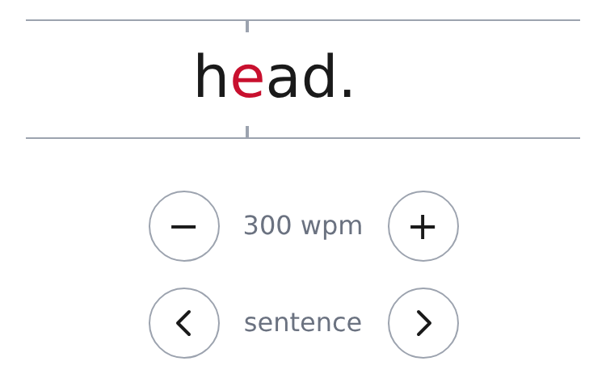
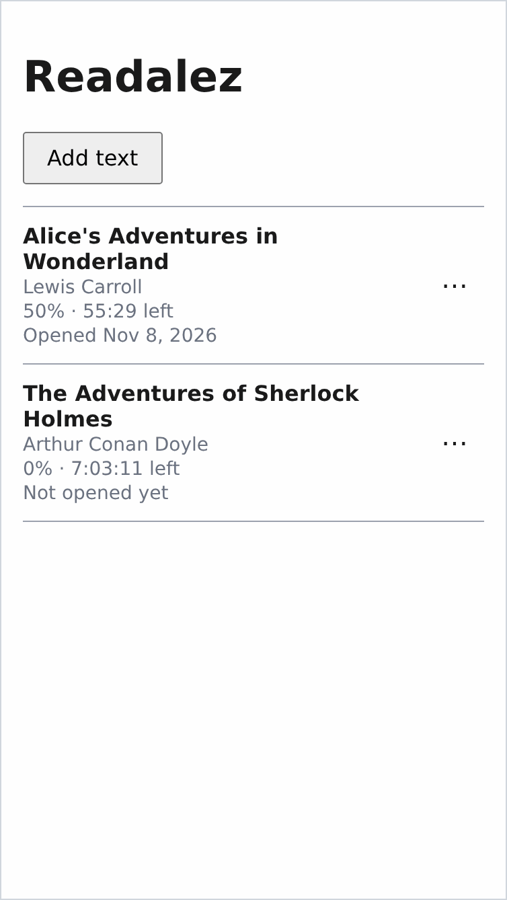
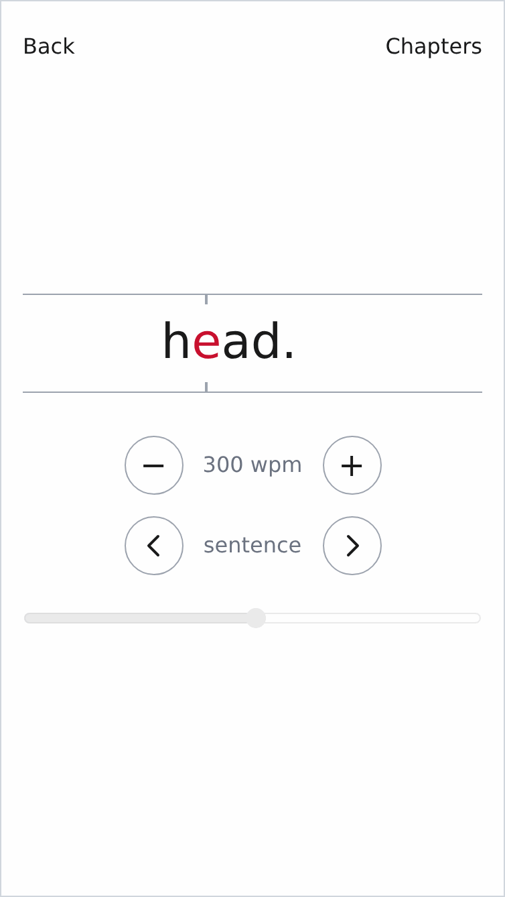
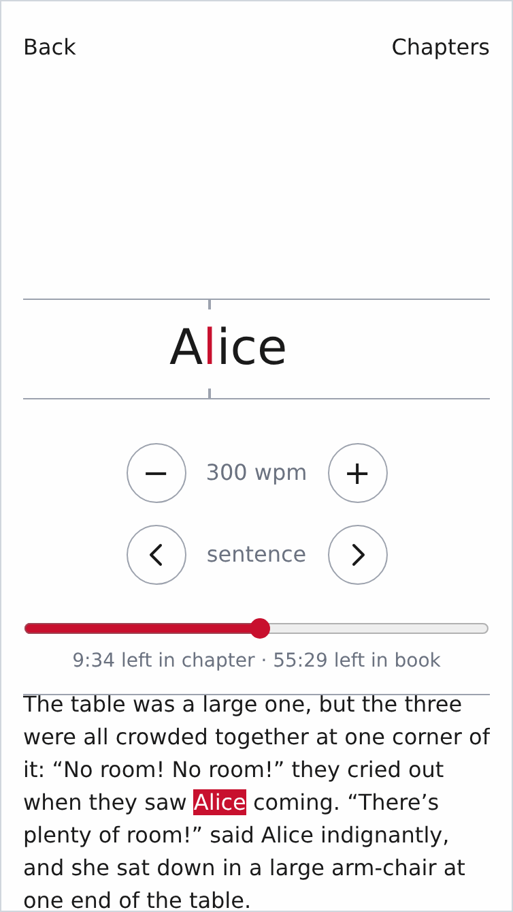
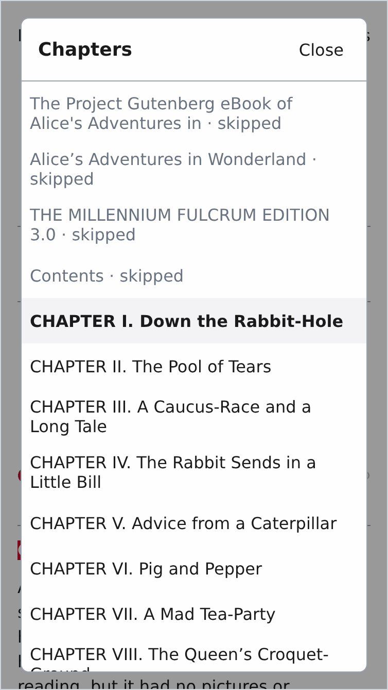

<p align="center">
  
</p>

<h1 align="center">Readalez</h1>

<p align="center">
  A free, open-source speed-reading web app for practicing on real, meaningful texts.<br>
  It shows a book one word at a time, with the focus letter highlighted and always on the same spot.
</p>

<p align="center">
  <picture>
    <source media="(prefers-color-scheme: dark)" srcset="docs/images/playing-dark.gif">
    
  </picture>
</p>

<p align="center">
  <picture>
    <source media="(prefers-color-scheme: dark)" srcset="docs/images/library-dark.png">
    
  </picture>
  <picture>
    <source media="(prefers-color-scheme: dark)" srcset="docs/images/reader-dark.png">
    
  </picture>
  <picture>
    <source media="(prefers-color-scheme: dark)" srcset="docs/images/paused-dark.png">
    
  </picture>
  <picture>
    <source media="(prefers-color-scheme: dark)" srcset="docs/images/chapters-dark.png">
    
  </picture>
</p>

<p align="center"><sub>Library, playing, paused and the chapter list, at phone size. The book is Project Gutenberg's <i>Alice's Adventures in Wonderland</i>, one of the <a href="tests/fixtures/epub/README.md">test books</a>.</sub></p>

## What works today

- **Paste a text** and start reading. Paragraphs are kept, hard-wrapped text such as Project Gutenberg's plain-text files is joined back into paragraphs, and Gutenberg's header and license are left out. The title comes from the first line, and you can change it.
- **Import EPUB books** (EPUB 2 and 3), with their title and author. Reading starts where the author's text starts, past Gutenberg's header, the title page and the contents, and the book is finished before Gutenberg's closing license. The skipped pages stay in the chapter list. Notes marked up as notes are gathered into one Notes section, and their markers are left out of the words.
- **One word at a time.** The focus letter is red and always lands on the same spot, so your eyes don't have to move. Very long words are split into parts ([details](SPEC.md#5-single-word-display)).
- **Timing that follows the text.** Long words, commas, sentence ends and paragraph ends each show for longer, at the speed you set ([details](SPEC.md#6-timing)).
- **Controls.** Tap the word to play or pause. Buttons change the speed and move back or forward a sentence; on a keyboard, Space, ← → and ↑ ↓ do the same. Drag the progress bar, or jump to a chapter from the chapter list.
- **Paused view.** When you pause, the chapter's text shows below the word with the current word marked, with time left for the chapter and the book. Tap any word to start from there.
- **Library.** Your books with their author, progress, time left and when you last opened them, most recent first. Rename or delete a book. Your place is saved as you read, so a book opens where you left off. Adding a book that's already there says so instead of making a copy.
- **On your device.** Books are read and kept in your browser's storage on this device, never uploaded. There are no accounts.
- **Light and dark** themes follow your system.

## Status

Readalez is before its first release (v1). What v1 is to do, and why, is in [SPEC.md](SPEC.md). Still to come, among others: settings, three built-in books, backup files, and finishing offline use and installing it as an app. Work in progress, bugs included, is in the [issues](https://github.com/Antananariwa/readalez/issues).

## Try it

The `main` branch is deployed to [readalez.pages.dev](https://readalez.pages.dev) ([ADR 0006](docs/adr/0006-host-on-cloudflare-pages.md)).

## Run it locally

With the Node.js version the dev container uses ([`.devcontainer/Dockerfile`](.devcontainer/Dockerfile)):

```sh
npm ci
npm run dev      # development server
npm run build    # production build into dist/
npm run preview  # serve the production build
npm run check    # typecheck, lint, format check and unit tests
npm run e2e      # Playwright end-to-end tests against the production build
```

`npm run e2e` needs Playwright's browsers: `npx playwright install --with-deps --only-shell chromium webkit`.

Where things are in the code: [ARCHITECTURE.md](ARCHITECTURE.md). Why the technical choices were made: [docs/adr](docs/adr/).

## How it's built

Coding agents write most of the code: they plan, write code and tests, and open pull requests. I direct the work: I decide what gets built, approve plans, test on physical devices and merge every pull request.

The agents work in an isolated environment with limited access ([ADR 0004](docs/adr/0004-run-claude-code-in-a-dev-container.md)), and they can't merge. Their working rules are in [CLAUDE.md](CLAUDE.md), and the reasons behind technical choices are in [docs/adr](docs/adr/).

## License

[MIT](LICENSE)
